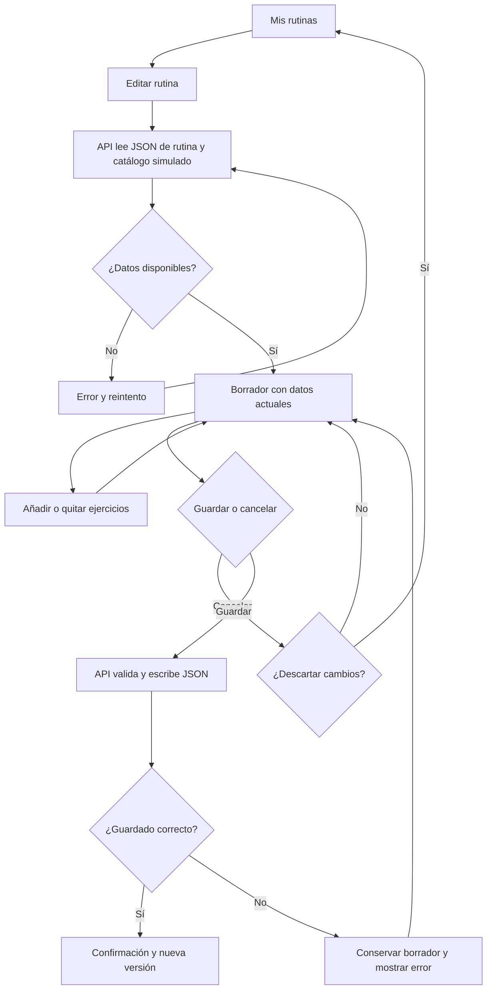
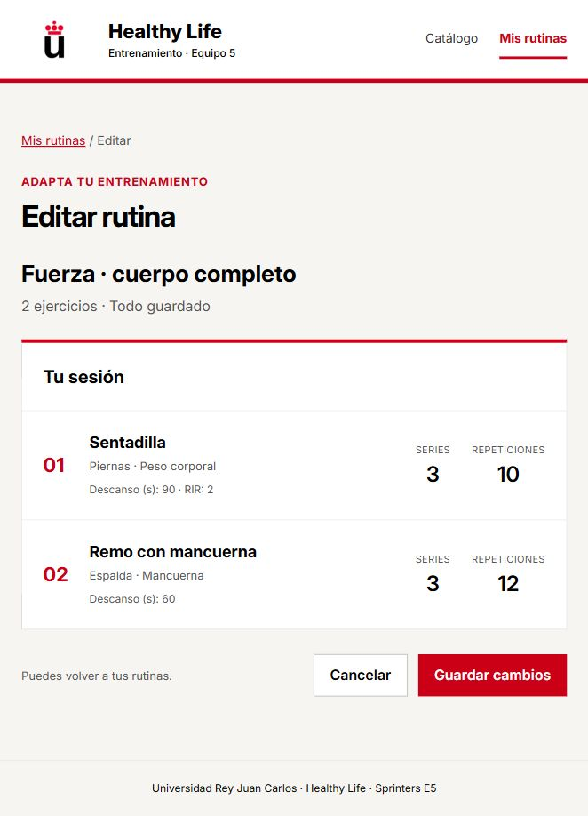
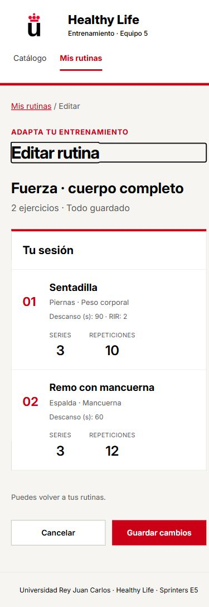
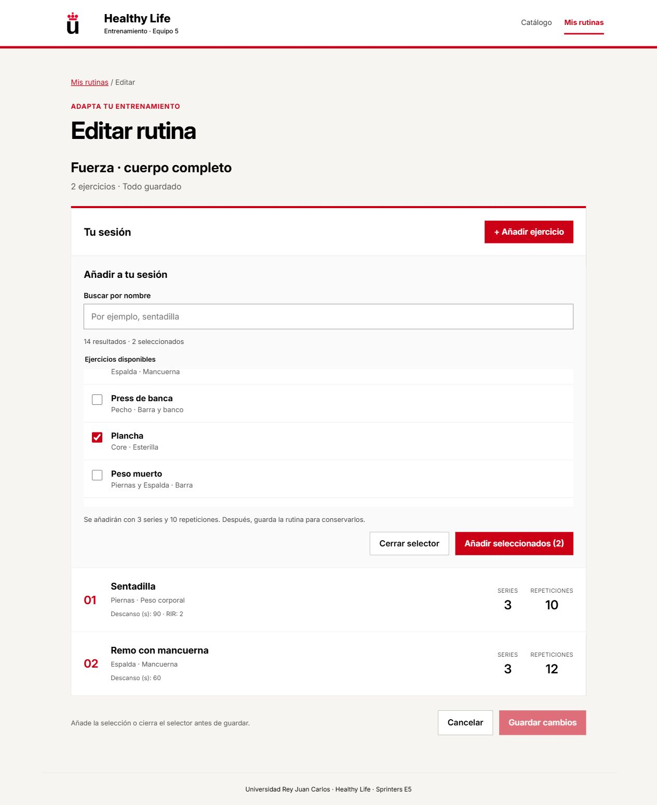
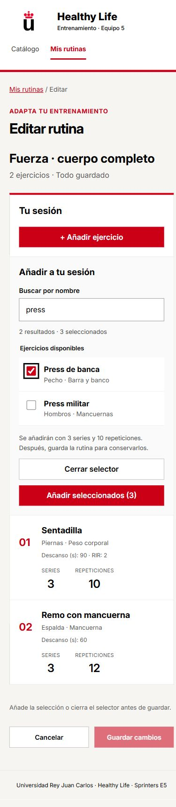

# HU08: edición de rutinas · contrato y revisión

Implementación de Fernán para SCRUM-89, SCRUM-83 y SCRUM-84. La revisión de otro
Developer y la aceptación de Ignacio (PO) se registran en Jira; este documento
no acredita ninguna de las dos. Las reglas de producto siguen pendientes de su validación.

## Contrato común HU02/HU08

Fuente de tipos y validación: `shared/routines.ts`. Rutina: `id`, `name`, `version`
(entero positivo) e `items`. Entrada: `id` propio, `exerciseId`, `sets`,
`repetitions`, `parameters` opcional (objeto con valores escalares JSON).
El orden del array es el orden de ejecución. Repetir un ejercicio está permitido
con distintos identificadores de entrada. Se admiten rutinas vacías.
Se conservan los parámetros extra (por ejemplo `restSeconds`, `rir`) en el borrador.
Los campos nuevos deben incorporarse al contrato compartido y sus validaciones.

| Ruta | Respuesta |
| --- | --- |
| GET /api/routines | Array de rutinas; vacío válido |
| GET /api/routines/:id | Rutina o 404 |
| PUT /api/routines/:id | Recibe `{name,version,items}`, devuelve rutina con versión incrementada |

400: datos inválidos (series/repeticiones enteras positivas, identificadores de
entrada únicos, ejercicios presentes en catálogo); 404: no existe; 409: versión
antigua, recargar tras decidir descartar el borrador; 500: fallo de almacenamiento
o catálogo. No se crea una rutina mediante PUT. JSON máximo 256 KiB y 500 entradas.
Las rutas directas sin `/api` también están disponibles, como el catálogo existente.

Los datos simulados se leen **en la API**: `api/data/exercises.json` y
`api/data/routines.seed.json`. Primer arranque: se copia la semilla a
`api/data/routines.local.json`, ignorado por Git. Las siguientes lecturas/escrituras
usan el archivo local. Un archivo dañado NO se sobrescribe con datos iniciales.
Las actualizaciones se serializan por archivo y se publican con renombrado de un
temporal en el mismo directorio. Garantía para **un proceso Node**; no ejecutar
varios procesos escritores contra el mismo JSON. Prototipo local sin autenticación:
solo datos ficticios, no es un sistema multiusuario desplegable.

## Puntos de continuación del equipo

- Joaquín (SCRUM-77/79): reutilizar el almacén y modelo para POST /api/routines;
  no reintroducir SQLite. No se dan por terminadas sus subtareas.
- Joaquín (SCRUM-78/88): formulario de creación y parámetros adicionales.
- Sergio (SCRUM-85/86): transformar `draft.items` conservando los ids y parameters;
  el guardado común persiste orden y parámetros. SCRUM-87 añadirá DELETE.
- Irene (HU07): el selector podrá reutilizar los filtros; la búsqueda por nombre
  de HU08 no sustituye el filtrado por grupo/etiquetas de HU07.

## Navegación y flujo para Miro

`#/catalogo` y `#/rutinas`; editar en `#/rutinas/:id/editar` permite recarga directa
sin configurar un router adicional en Express. El editor lee rutina y catálogo
por API; si alguno falla, muestra el error y permite reintentar.

Propuesta para trasladar a Miro, **no acredita que se haya actualizado Miro**.
La integración con datos externos de otros equipos no se inventa: el JSON del
catálogo es actualmente interno de E5; el SM debe señalar los datos externos reales
del Sprint en el diagrama general cuando se acuerden.

## Identidad visual

Manual URJC pp. 4, 13, 15, 20, 22: rojo #CB0017, blanco, negro; Inter local
(licencia OFL incluida), alternativa Arial. Marca sin deformar ni recolorear;
bandas rojas, jerarquía sencilla y controles con texto. Grises auxiliares de UI.
Logo copiado del recurso existente a public/brand para funcionar también compilado.

## Revisión reproducible

1. `npm ci` y `npm run check` (Windows: `npm.cmd`).
2. `npm run dev`; abrir http://127.0.0.1:5173/#/rutinas.
3. Abrir la rutina de fuerza: comprobar nombre, dos ejercicios y parámetros.
4. Guardar, cancelar y volver a abrir; repetir con recarga directa del editor.
5. Comprobar rutina vacía e identificador inexistente.
6. Al completar SCRUM-83/84: añadir varios y repetidos, guardar y recargar;
   quitar solo una entrada, guardar y recargar; repetir con Cancelar (se descarta).
7. Dos pestañas editando la misma versión: guardar una y comprobar 409 en la otra.
8. API detenida al guardar: error sin perder borrador y reintento al arrancarla.
9. Verificar móvil, teclado, foco, ausencia de desplazamiento horizontal y logo/fuente.
10. `npm run build` y `npm start`; comprobar también http://127.0.0.1:3001/#/rutinas.

Las pruebas HTTP usan archivos temporales aislados, nunca el JSON local del usuario.
La demo oral: modificar → cancelar → reabrir sin cambios → modificar → guardar →
recargar con cambios. Explicar qué impide perder datos y enseñar revisión real del PR.

## Evidencia de SCRUM-89 · 22/10/2026

PR: https://github.com/fernanrama/sprinters-e5/pull/12.
`npm run check`: tipos, 16 pruebas HTTP y compilación correctos.
Arranque compilado comprobado con `npm start`; apertura desde listado, datos actuales,
Guardar, Cancelar, recarga directa, rutina vacía y error 404 verificados en navegador.
Catálogo conservado con 14 ejercicios. Logo y fuente Inter locales cargados.
Prueba móvil a 390 px, sin desbordamiento horizontal; distribución de parámetros revisada.

Esta primera PR aún no ofrece añadir ni quitar, ordenar o editar series/repeticiones.
El aviso de descarte de un borrador modificado se verificará al incorporar esas
acciones; no se presenta como una prueba interactiva completada en SCRUM-89.
Pendientes: revisión de otro Developer, integración y aceptación de Ignacio.

## SCRUM-83 · Añadir ejercicios

Rama `feature/SCRUM-83-anadir-ejercicios`, basada en la PR #12. Revisar el cambio
contra `feature/SCRUM-89-vista-edicion-rutina`; integrar primero la base y después
cambiar el destino de esta PR a main. No integra SCRUM-84.

El selector permite búsqueda por nombre (ignora tildes y mayúsculas), selección
múltiple y conserva la selección entre búsquedas. Cerrar el selector descarta su
selección sin modificar el borrador. Añadir seleccionados incorpora entradas con
id propio y valores iniciales 3/10; se pueden repetir ejercicios en distintas
incorporaciones. El límite coincide con la API (500 entradas).

El botón Guardar queda desactivado mientras está abierto el selector: primero hay
que incorporar la selección o cerrarlo. Añadir solo modifica el borrador; Guardar
usa el PUT existente y conserva los parámetros anteriores y el resto de rutinas.
Cancelar con cambios abre un diálogo accesible: Seguir editando conserva el borrador
y Descartar cambios vuelve al listado. Escape cierra el diálogo sin descartar.
Salir/recargar la página conserva además el aviso nativo del navegador.
La selección pendiente del selector todavía no incorporada no se guarda.

Pruebas del 22/10/2026:
- `npm run check` correcto: tipos, **20 pruebas** y compilación.
- Arranque compilado comprobado con `npm start`.
- Navegador: búsqueda sin tildes, sin coincidencias, selección entre búsquedas,
  incorporación múltiple/repetidos, guardado y recarga con datos conservados.
- Ambas opciones del diálogo de cancelación comprobadas; cerrar selector no añade.
- API detenida durante guardar: error en español, borrador conservado y reintento
  correcto tras arrancar el servidor, seguido de recarga.
- Aislamiento de rutinas y conservación de parámetros comprobados con JSON UTF-8.
- Móvil a 390 px sin desbordamiento; búsqueda y casillas con Tab/Espacio.
- Los datos locales de demostración se restauraron al contenido previo tras probar.

Pendientes: revisión de otro Developer, aceptación del PO e integración. Estas
pruebas no acreditan HU08 completa. Orden, edición de parámetros y eliminación
permanecen en sus tarjetas; los filtros de grupo/etiqueta de Irene no se sustituyen.
